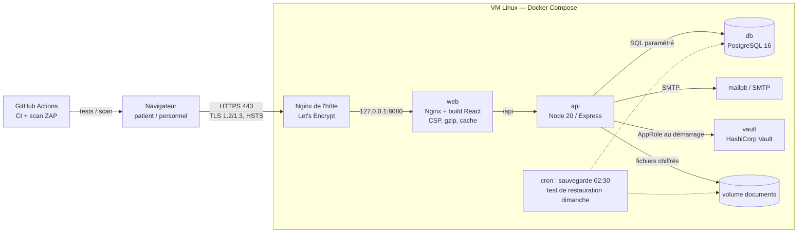

# Architecture de MedLink (US-54, mise à jour US-65)

Portail web sécurisé de prise de rendez-vous et d'accès au dossier médical pour trois cliniques (Sousse, Sfax, Tunis).
Application monopage React servie par Nginx, API REST Node.js/Express, base PostgreSQL 16, le tout en conteneurs Docker.

## 1. Déploiement (production)

Seul le port 443 est exposé. PostgreSQL, Mailpit et Vault n'ont aucun port publié.

## 2. Composants de l'API

| Couche | Fichiers | Rôle |
|---|---|---|
| Entrée | `src/server.js`, `src/app.js` | secrets (Vault), helmet, limites de débit, horaires 6 h – 22 h, montage des routes, erreurs génériques |
| Middlewares | `middleware/auth.js`, `middleware/validate.js` | session JWT (cookie), `requirePermission`, `refuser` ; schémas Joi |
| Routes | `routes/*.js` (19 routeurs) | une ressource par fichier : `session`, `mfa`, `inscription`, `motDePasse`, `activation`, `comptes`, `roles`, `disponibilites`, `praticiens`, `creneaux`, `rendezVous`, `patients`, `documents`, `praticien`, `accueil`, `audit`, `maintenance`, `demandes`, `statistiques` |
| Sécurité | `security/*.js` | `chiffrement` (AES-256-GCM), `session`, `mfa`/`totp`, `bruteforce`, `passwordPolicy`, `soins` (relation de soins), `acces` (journal des dossiers), `surveillance` (accès suspects), `journal` (événements), `horaires`, `vault`, `tokens` |
| Services | `services/*.js` | `notifications` (e-mail/SMS selon préférences), `mailer`, `sms`, `rappels` (cron 15 min), `stockage` (documents chiffrés, PDF), `donnees` (export INPDP), `anonymisation` |

## 3. Frontend

React 19 + Vite + React Router. `App.jsx` charge chaque page à la demande (`React.lazy`) ; `AppLayout.jsx`
construit le menu à partir des permissions du jeton ; `api.js` centralise les appels (même origine, cookies),
le minuteur d'inactivité et l'envoi de fichiers. Espaces : patient, praticien, accueil / back-office, administration, Direction.

## 4. Modèle de données (migrations `db/migrations/001` à `007`)

| Domaine | Tables |
|---|---|
| Comptes et droits | `utilisateurs`, `patients`, `praticiens`, `personnels`, `roles`, `permissions`, `role_permission`, `sessions`, `jetons_securite`, `consentements`, `preferences_notification` |
| Cliniques et planning | `cliniques`, `praticien_clinique`, `plages_disponibilite`, `creneaux`, `absences` |
| Rendez-vous | `rendez_vous` (motif chiffré, origine en ligne / accueil), `notifications` |
| Dossier médical | `dossiers_medicaux`, `documents_medicaux` (fichier chiffré + empreinte), `comptes_rendus` (texte chiffré) |
| Sécurité et conformité | `journal_acces_dossiers` (ajout seul), `alertes_securite`, `demandes_donnees` (export chiffré), `annonces_maintenance` |

Diagrammes détaillés : `docs/uml/` (PlantUML : cas d'usage, classes, composants, déploiement, séquences).

## 5. Flux de sécurité principaux

1. **Connexion** : mot de passe (Argon2id) → verrouillage après 5 échecs → MFA TOTP pour le personnel →
   jeton d'accès + jeton de rafraîchissement en cookies `HttpOnly; Secure; SameSite=Strict` → expiration à 15 min d'inactivité, 8 h max.
2. **Autorisation** : permission dans le jeton (matrice `role_permission`, modifiable par l'admin) → contrôle par route →
   pour un dossier, relation de soins → écriture dans `journal_acces_dossiers` **avant** l'envoi → surveillance du volume d'accès.
3. **Données** : champs médicaux en AES-256-GCM avec un contexte (identifiant de l'enregistrement), clés versionnées ;
   documents chiffrés sur disque, empreinte vérifiée à la lecture ; sauvegardes chiffrées une seconde fois.
4. **Secrets** : Vault (AppRole) au démarrage, jeton révoqué ; développement : `.env` non versionné.
5. **Chaîne de livraison** : branche par user story → PR relue → CI (lint, 25+ fichiers de tests sur PostgreSQL réel, build, `npm audit`) →
   Squash and merge → déploiement sur la VM → scan ZAP.
